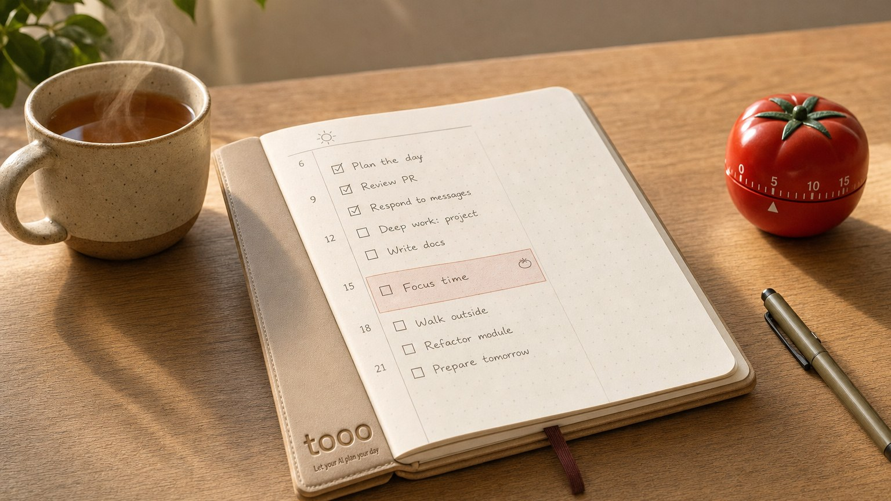

[中文](./README.md)

# tooo-plugins

Let Claude and Codex read and write your tooo to-do list and focus timer: say one sentence, and tasks get scheduled, the timer starts, reminders are set.

<p align="center">
  
</p>

tooo is a to-do list and focus timer: tasks and steps, a pomodoro timer, time records, day and week reviews, and reminders when it is time. Website: <https://tooo.site>. Web app: <https://app.tooo.site>. This repository is its plugin: once installed, your assistant is connected to tooo and carries a skill that explains how each tool works.

## What it looks like

[To add: evidence. Suggested content: use a demo account; on the left, the conversation "Put tomorrow's three things into tooo and remind me at 9"; on the right, the tasks that appear in the tooo web app. Do not use a real account, which would expose personal tasks.]

## Status and limits

- **Account**: tooo is in private beta. Accounts are invite-only and sign-up is closed. Without an account the plugin cannot connect, and your assistant will not register one for you.
- **Where it works**: Claude Code, the Claude apps (web, Windows and Mac desktop) and Codex (CLI and desktop app; the IDE extension does not support plugins). Tested here: Claude Code, where the tooo tools and skill load once the plugin is installed. tooo's [connect page](https://tooo.site/connect/) marks the Claude apps and Codex as "Verified"; this repository has not re-checked that [to verify]. No local dependencies: no Node or Python.
- **Data and permissions**: the plugin holds only the connection address, no secrets. Until you approve, the assistant sees no data. After that it can read and write every task, timer, time record, weekly review and reminder setting in the account, and what it reads goes into the context of the model you use. tooo marks deleting a task, stopping a repeat, undoing a timer start and cutting recorded time as needing confirmation every time: Claude Code asks each time, other clients follow their own settings.
- **What it cannot do**: tooo does not call a large language model itself, so summaries and advice come from your assistant. It also never wakes the assistant up, so "write my weekly review every Sunday" needs a scheduled task of your own, or a request in conversation.
- **Maintenance**: maintained by tooo; current version 0.3.0; no release published; MIT license.

## Install (three steps)

Prerequisites: a tooo account, and one of Claude Code, the Claude apps or Codex.

### 1. Install the plugin

**Recommended**: send this sentence to your assistant. It installs the plugin following [`docs/install.md`](./docs/install.md) and walks you through authorization.

```text
Connect tooo for me: https://raw.githubusercontent.com/RZX00/tooo-plugins/main/docs/install.md
```

Or install it yourself, one row for your client:

| Client | How |
|---|---|
| Claude Code | `/plugin marketplace add RZX00/tooo-plugins`, then `/plugin install tooo@tooo-plugins` (the second command opens the plugin's details; install from that panel), then run `/reload-plugins` |
| Codex | `codex plugin marketplace add RZX00/tooo-plugins`, then `codex plugin add tooo@tooo-plugins`; or run `codex`, type `/plugins`, choose the tooo marketplace and install |
| Claude apps | Customize → Plugins → Add → Add marketplace, enter `RZX00/tooo-plugins`; pick tooo in Discover and click Add |

### 2. Authorize (installing the plugin does not connect your account)

In Claude Code, run `/mcp` and sign in to tooo. In Codex, start a new session and follow the prompt. In the Claude apps, open the plugin's Connectors tab and click Connect.

The account owner approves on the authorization page. If the browser is already signed in to tooo, click Approve. If not, the page shows a 6-digit code: on a device that is signed in, open More → Devices → Add a device in the tooo app and enter it.

### 3. Say one sentence to your assistant

See the next section.

## First use

Read first, then write. Once authorized, say:

```text
Use tooo to show me what is on my list today
```

You get: your assistant lists today's tasks (it calls `list_tasks` with `view` set to `today`). This step only reads; it confirms the connection works.

Then write one, naming tooo:

```text
Use tooo to put tomorrow's three things on my list: write the weekly report, book flights, go to the gym. Remind me at 9 tomorrow morning.
```

Expected (from the tool definitions in [`SKILL.md`](./plugins/tooo/skills/tooo/SKILL.md)): three new tasks appear in tomorrow's list, each with a 9:00 reminder, and the assistant's reply lists the titles and reminder times. The web app or your phone shows the same three. [To add: a real screenshot of this step, see "What it looks like"]

A few more to try:

| Say to your assistant | Tool used |
|---|---|
| `Use tooo to start focusing on: write the weekly report` | `start_focus` |
| `Use tooo to log 2 to 3 this afternoon as gym time` | `add_time_entry` |
| `Use tooo to show me this week's review data` | `get_weekly_review` |
| `Use tooo to make "write the weekly report" repeat on Monday, Wednesday and Friday` | `set_repeat` |

## Why use it

Without a connection, your assistant can only list tasks in the chat and you copy them into tooo; with it, the assistant works on the data in tooo directly.

| What you want | No connection | With the plugin |
|---|---|---|
| Plan tomorrow | Ask for a list, then create each task yourself | The assistant creates the tasks with date, time and reminder |
| Log time | Fill in start and end yourself | Say "2 to 3 this afternoon, gym"; the assistant logs it, and any part overlapping other records is logged as concurrent |
| Weekly review | Scroll through the week yourself | The assistant reads the week's finished tasks, timer minutes and pomodoros, drafts the review, and saves it as a new version with `save_weekly_review`; older versions are kept |

## What it can do, and how it works

The assistant reaches your account through `https://app.tooo.site/mcp` (Streamable HTTP, OAuth); the `tooo` skill tells it each tool's parameters and limits. [`SKILL.md`](./plugins/tooo/skills/tooo/SKILL.md) lists 37 tools in eight groups:

| Group | Tools |
|---|---|
| Tasks (8) | `list_tasks`, `get_task`, `create_task`, `update_task`, `complete_task`, `delete_task`, `restore_task`, `reorder_tasks` |
| Steps and repeats (4) | `add_step`, `set_repeat`, `stop_repeat`, `list_repeats` |
| Focus timer (10) | `start_focus`, `focus_status`, `pause_focus`, `resume_focus`, `stop_focus`, `cancel_focus`, `start_break`, `end_break`, `get_focus_settings`, `set_focus_settings` |
| Time records (2) | `add_time_entry`, `day_timeline` |
| Reviews (4) | `day_summary`, `get_weekly_review`, `list_weekly_reviews`, `save_weekly_review` |
| Reminders (3) | `remind`, `list_reminders`, `cancel_reminder` |
| Proactive prompts (5) | `prompts`, `act_prompt`, `cut_prompt_time`, `get_prompt_settings`, `set_prompt_settings` |
| Device usage (1) | `device_usage` |

### What is in this repository

| Path | Purpose |
|---|---|
| `.claude-plugin/marketplace.json` | Marketplace catalog read by Claude Code and the Claude apps |
| `.agents/plugins/marketplace.json` | Marketplace catalog read by Codex |
| `plugins/tooo/.claude-plugin/plugin.json`, `plugins/tooo/.mcp.json` | Claude plugin manifest and connection config |
| `plugins/tooo/plugin.json`, `plugins/tooo/mcp.json` | [Agent Plugins](https://agent-plugins.org) 1.0.0 manifest and connection config, read by Codex |
| `plugins/tooo/skills/tooo/SKILL.md` | The skill both sides share: tools, parameters and limits |
| `docs/install.md` | Install instructions written for agents |

## FAQ

**The plugin is installed, but my assistant says it has no tooo tools.** In Claude Code, run `/reload-plugins` or start a new session, then run `/mcp` to check that tooo is signed in.

**Can my assistant click Approve for me?** No. The account owner approves on the authorization page.

**Can I get back a task I deleted?** Deleting a task and stopping a repeat can both be undone: ask your assistant to use `restore_task`.

**I want to stop using it.** Remove the connection under More → Devices in tooo.

<details>
<summary>Connector only, no plugin</summary>

Connection only, without the skill's explanations. The connector address is `https://app.tooo.site/mcp` everywhere. tooo's [connect page](https://tooo.site/connect/) marks the first three direct routes as "Not yet tested" (written from each vendor's public docs, not tried); the key route for Hermes Agent is marked "Verified".

| Client | How |
|---|---|
| Claude apps | Open [this link](https://claude.ai/customize/connectors?modal=add-custom-connector&connectorName=tooo&connectorUrl=https%3A%2F%2Fapp.tooo.site%2Fmcp) (the form is pre-filled), click Add, then Connect. Add it once on the web or desktop, and it is available on your phone when you sign in with the same account. |
| Claude Code | `claude mcp add --transport http --scope user tooo https://app.tooo.site/mcp`, then sign in with `/mcp` inside a session. |
| Codex | `codex mcp add tooo --url https://app.tooo.site/mcp`, then `codex mcp login tooo`. The IDE extension uses this route. |
| Hermes Agent | Generate a command-line key (starts with `tk_`) under More → Devices in tooo, and put it in Hermes's config as the Hermes entry on the [connect page](https://tooo.site/connect/) shows. Never put the key in a task or a conversation. |

Other clients are on the connect page too, each marked as verified or not.

</details>

## Issues and license

Report problems and suggestions as [issues](https://github.com/RZX00/tooo-plugins/issues). MIT license, see [`LICENSE`](./LICENSE).
